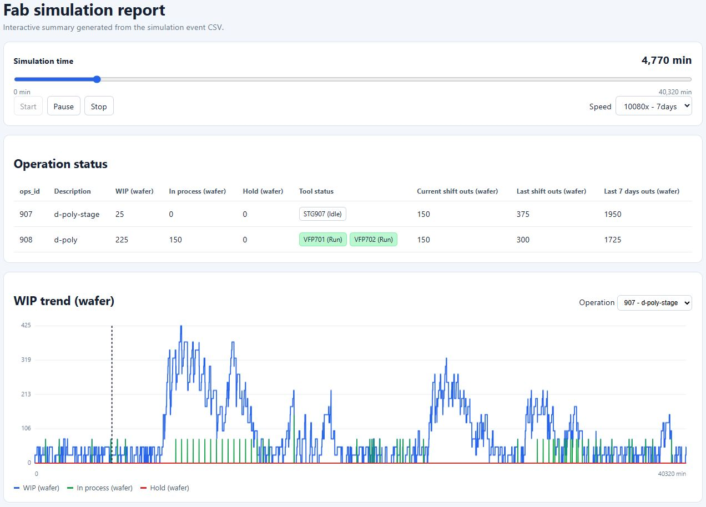

# Poly-operation fab simulation

This repository contains a small SimPy discrete-event simulation driven by the
three configuration files in `data/`:

- `poly_config_ops.csv` defines operations 907 (`d-poly-stage`) and 908
  (`d-poly`), including each operation's maximum queue time.
- `poly_config_tool.csv` defines the tools. STG907 is configured as a virtual
  tool; VFP701 and VFP702 are furnace tools with preventive-maintenance limits.
- `poly_config_tool-ops.csv` maps tools to operations and defines wafer batch
  limits and processing time per load.

## Simulation parameters

Edit `data/simulation_parameters.csv` to set the run inputs:

| Parameter | Meaning |
| --- | --- |
| `lots_per_shift` | Average number of arriving lots per 12-hour shift. Arrivals are stochastic, not evenly spaced. |
| `duration_hours` | Total simulated time. The simulation stops at this time; it does not drain unfinished work. |
| `wafers_per_lot` | Wafer count assigned to each created lot. |
| `op_907_release` | Maximum number of full operation 908 batches reserved per tool, including batches moving through 907, processing, or queued for dispatch. The 907 controller holds lots in 907 WIP when downstream slots are full or a release could breach operation 908 queue time. |
| `random_seed` | Seed for reproducible random lot-arrival times. |

The checked-in parameter file currently specifies an average of 11 lots per
shift, 672 simulation hours, 25 wafers per lot, two full batches per operation
908 tool, and seed 1. This arrival rate is intended to match the combined VFP
capacity; arrivals remain stochastic, so 11 is not a hard per-shift maximum.

## Current simulation behavior

Install the dependency and run the simulator from the repository root:

```sh
python -m pip install -r requirements.txt
python -m fab_sim
```

Lot arrivals follow a Poisson process. Operation 907 is processed one lot at a
time on STG907. For operation 908, the configured batch limits are 37–75
wafers: with 25 wafers per lot, two lots meet the minimum and three lots fill a
75-wafer load. The operation 907 release controller waits for three arrived
lots before releasing them to STG907, so operation 908 receives full 75-wafer
batches without a timed wait for a third lot. It limits each operation 908 tool
to the configured number of reserved batches, including batches moving through
907, in process, and queued for dispatch. Before releasing a batch, it checks
the selected tool's queue and PM state against operation 908's queue-time
limit. A lot enters operation 907 WIP when it is created, so lots waiting for a
full-batch release or a safe downstream slot remain visible in 907 WIP and
accrue operation 907 queue time until processing starts.

VFP701 and VFP702 are parallel tools for operation 908. Each load counts as one
run for PM, whether it contains two or three lots. PM is triggered by whichever
configured enabled limit is reached first: run count or elapsed time. A
time-triggered PM waits for an active load to finish before taking the tool
offline. Queue-time limits are checked against each lot's elapsed time in the
operation from move-in until it starts processing. A lot that exceeds the limit
while waiting is still processed and changes to `hold` when it completes the
operation.

## Planned extensions

Potential areas for future study and development:

1. **Low-WIP release strategy:** When incoming WIP is low, compare releasing
   two lots at operation 907 with waiting for a full three-lot batch. Evaluate
   the impact on furnace utilization, throughput, and queue-time risk.
2. **Furnace loading and dual-boat operation:** Model dual-boat furnace
   cascading, where batches can be staged to reduce loading delays. Add a
   configurable furnace loading window.
3. **Unplanned equipment downtime:** Extend equipment availability scenarios
   beyond preventive maintenance to include alarms and hard downs.
4. **Predictive monitoring and WIP control:** Explore AI-assisted monitoring
   of equipment and process signals, including R2R, FDC, and SPC, to predict
   downtime risk and proactively manage WIP.
5. **Queue-time loop studies:** Add operation-chain queue-time limits and
   study nested queue-time loops across multiple operations.

## Output

By default, the simulation writes these files to `output/`:

- `events.csv`: combined chronological event log.
- `lot_history.csv`: events for each lot, including status and operation
  transitions.
- `tool_history.csv`: tool processing and PM events, with associated lot IDs.

Times in the logs are simulated minutes. Change the output path with
`--output-dir`, or the configuration directory with `--data-dir`.

## Interactive analysis report

The standalone report reads the existing event log and configuration CSVs. It
does not rerun or modify the simulation, and it uses only the Python standard
library:



```sh
python tools/generate_report.py
```

By default, this reads `output/events.csv` and creates
`output/analysis_report.html`. Open that HTML file in a browser to use the
timeline slider and playback controls, view operation status, and explore the
WIP trend. Start begins playback, Pause temporarily stops it, and Stop returns
the timeline to the beginning. Playback speeds are 1x (1 simulated minute per
real minute), 10x (10 minutes), 60x (1 hour), 180x (3 hours), 720x (12 hours),
1440x (24 hours), 4320x (3 days), and 10080x (7 days). If the event log is not
present yet, run `python -m fab_sim` first.

The report displays WIP, in-process, hold, and outs quantities in wafers.
Current shift outs cover the current 12-hour shift to the selected time; last
shift outs cover the previous 12-hour shift; last 7 days outs cover the rolling
7 days ending at the selected time. Only lots that successfully leave an
operation are counted as outs. Tool badges show the status at the selected
simulation time: Idle (white), Run (green), or PM (yellow). The default
sampling interval is 5 simulated minutes; change it with `--step-minutes`:

```sh
python tools/generate_report.py --step-minutes 1
```

To open the report in a remote development environment, serve the `output/`
directory and use the forwarded port in your browser:

```sh
python -m http.server 8000 --directory output
```

Then open `http://localhost:8000/analysis_report.html` (or use the environment's
port-forwarding link). Stop the server with `Ctrl+C`.
